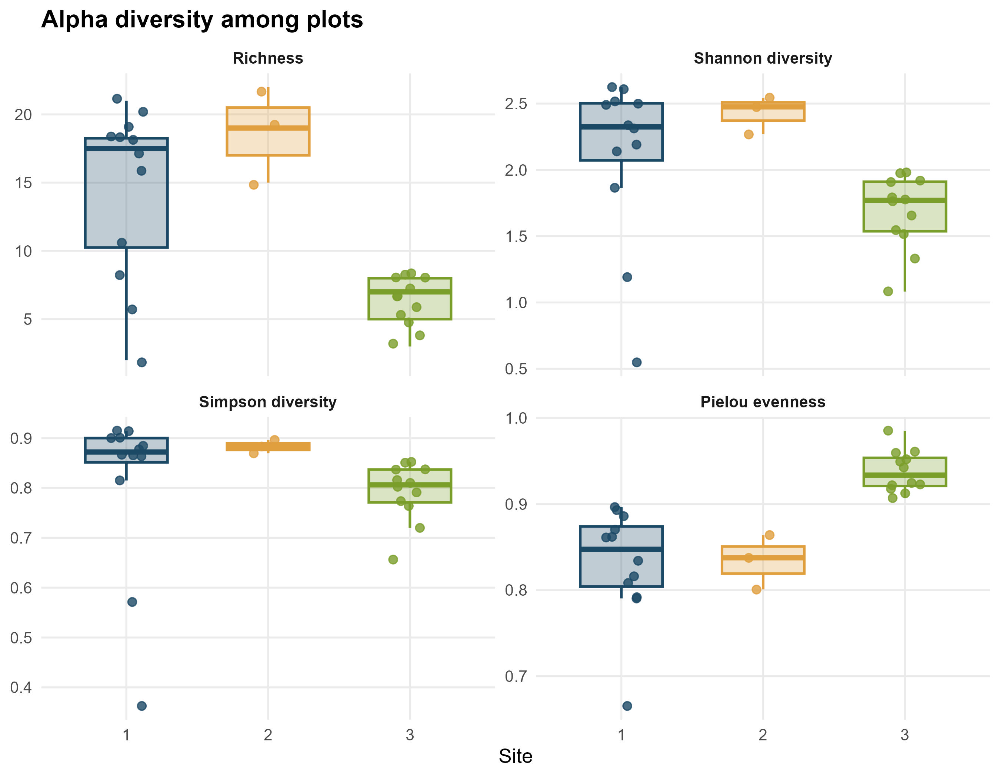

## Introducción

La diversidad alfa permite describir la diversidad de especies dentro de una unidad de muestreo y comparar las características de las comunidades biológicas entre diferentes sitios. Para ello, se utilizan índices que consideran distintos componentes de la diversidad, como la riqueza de especies, la diversidad de Shannon, la diversidad de Simpson y la equidad de Pielou. Estos índices permiten evaluar tanto la cantidad de especies presentes como la distribución de sus abundancias dentro de una comunidad. En esta práctica se analizaron los patrones de diversidad alfa de la comunidad vegetal en tres sitios de estudio, utilizando registros de abundancia por parcela para comparar la variación de estos índices entre sitios.

## Objetivo

Calcular y comparar la diversidad alfa de la comunidad vegetal en tres sitios de estudio mediante los índices de riqueza de especies, Shannon, Simpson y equidad de Pielou, utilizando las abundancias registradas en las diferentes parcelas.

## Metodología

La práctica se realizó en RStudio mediante los paquetes sf, tmap, vegan, cowplot y tidyverse. Se importó la base de datos de registros de especies vegetales (`ccb_dataset.rds`), compuesta por 8374 registros, que contenía información sobre las parcelas, los sitios de muestreo, las especies y sus coordenadas geográficas. Se identificaron tres sitios de estudio y se transformaron las coordenadas geográficas en un objeto espacial mediante el paquete sf, utilizando el sistema de referencia WGS84 (EPSG:4326).

Posteriormente, se calcularon las abundancias de cada especie por sitio y se construyeron matrices de comunidad a partir de las abundancias registradas. Para evaluar la diversidad alfa por parcela, se organizaron los registros según el sitio, la parcela y la especie, y se calcularon cuatro índices: riqueza de especies (S), diversidad de Shannon (H), diversidad de Simpson (1-D) y equidad de Pielou (J). La riqueza se obtuvo mediante `specnumber()`, mientras que los índices de Shannon y Simpson se calcularon mediante la función `diversity()` del paquete vegan. La equidad de Pielou se calculó dividiendo el índice de Shannon entre el logaritmo natural de la riqueza de especies.

Finalmente, los valores de los cuatro índices se organizaron en formato largo y se representaron mediante diagramas de cajas (*boxplots*), acompañados de puntos que muestran los valores correspondientes a cada parcela. Los gráficos se agruparon en una sola figura mediante `facet_wrap()`, diferenciando los tres sitios con colores. La figura se exportó en formato JPG con una resolución de 300 dpi.

## Resultados

Se analizaron 8374 registros de abundancia correspondientes a 31 especies vegetales distribuidas en tres sitios de estudio. El sitio 1 presentó 4196 registros y 28 especies, el sitio 2 registró 3956 registros y 27 especies, mientras que el sitio 3 presentó 222 registros y 12 especies.

En cuanto a la diversidad alfa, los resultados mostraron diferencias entre los sitios. A nivel de sitio, el índice de Shannon fue mayor en el sitio 1 (H = 2,85), seguido del sitio 2 (H = 2,69) y el sitio 3 (H = 2,35). La diversidad de Simpson también presentó su valor más alto en el sitio 1 (0,920), seguido del sitio 2 (0,902) y el sitio 3 (0,896). Por otra parte, la equidad de Pielou fue mayor en el sitio 3 (J = 0,946), mientras que los sitios 1 y 2 presentaron valores de 0,854 y 0,815, respectivamente.

La figura 1 muestra la variación de los cuatro índices de diversidad alfa entre las parcelas de los tres sitios. Se observa que los sitios 1 y 2 presentan valores de riqueza y diversidad de Shannon generalmente superiores a los del sitio 3. En cambio, el sitio 3 presenta valores más elevados de equidad de Pielou, lo que indica una distribución más uniforme de las abundancias relativas de las especies en comparación con los otros sitios.

## Conclusiones

La práctica me permitió calcular e interpretar diferentes índices de diversidad alfa mediante el uso de RStudio y el paquete vegan. Además, aprendí a construir matrices de comunidad, calcular índices de diversidad y representar gráficamente sus variaciones entre parcelas y sitios de estudio.
