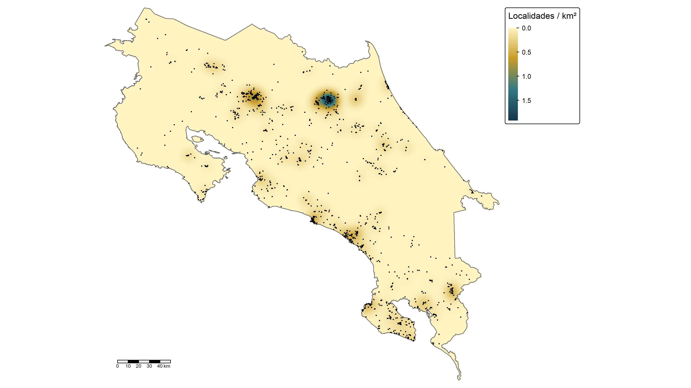

## Introducción

Los registros de ocurrencia suelen concentrarse en ciertos sitios, y la estimación de densidad kernel (KDE) permite resumir esa concentración en una superficie continua. Esta técnica es útil para identificar las zonas donde se agrupan las localidades registradas de una especie y para delimitar regiones de mayor concentración. Sin embargo, la densidad de registros no equivale a la abundancia de la especie ni a la idoneidad del hábitat, porque depende también del esfuerzo de muestreo. Esta práctica aplicó el KDE a los registros de *Craugastor fitzingeri* en Costa Rica.

## Objetivo

Estimar la densidad kernel de las localidades de registro de *Craugastor fitzingeri* en Costa Rica, representarla en un mapa y delimitar las regiones que concentran el 50 % y el 95 % de la densidad.

## Metodología

La práctica se realizó en RStudio con los paquetes terra, sf, tmap, tidyverse y spatstat (spatstat.geom y spatstat.explore). Se leyeron la capa de Costa Rica y la base de registros depurados, sin coordenadas oscurecidas. Se conservó una observación por localidad (coordenadas únicas), para que las coordenadas repetidas no aportaran más peso a la densidad, y se seleccionaron las localidades que intersectan Costa Rica.

Las capas y los registros se transformaron al sistema de coordenadas proyectadas CR05 / CRTM05 (EPSG:5367), porque el KDE requiere distancias en metros. Se definió una ventana rectangular de cálculo con un margen alrededor del país, se creó el objeto de puntos con ppp() y se estimó la densidad con density() usando un núcleo gaussiano con ancho de banda (sigma) de 5 000 m, celdas de 500 m y sin corrección de borde.

La superficie resultante se convirtió en un ráster, se recortó y enmascaró con el contorno de Costa Rica, se corrigieron los valores negativos por aproximación numérica y se expresó en localidades por km². Con las celdas ordenadas de mayor a menor densidad se calculó la proporción acumulada de la densidad total y se identificó el umbral correspondiente al 50 % y al 95 %. Con esos umbrales se generaron los polígonos de cada nivel. Los mapas se elaboraron con tmap y se guardaron en JPG a 300 dpi. El ráster y los polígonos se guardaron en formatos GeoTIFF, GeoPackage y RDS.

## Resultados

Se estimó la densidad kernel de las localidades de registro de *Craugastor fitzingeri* en Costa Rica, usando un núcleo gaussiano con ancho de banda de 5 000 m y celdas de 500 m. El análisis se hizo con una observación por localidad, para que las coordenadas repetidas no aportaran más peso a la superficie. El resultado es una superficie continua que se expresó en localidades por km² y se recortó al territorio nacional.

En el mapa, los valores altos de densidad corresponden a las zonas donde se agrupan las localidades registradas, y los valores bajos o nulos, a las zonas con pocos registros o sin ellos. Esta superficie permite identificar las áreas de mayor concentración de registros y distinguirlas de las que no han sido muestreadas. Sin embargo, la densidad no representa la abundancia de la especie ni la idoneidad del hábitat, porque depende también del esfuerzo de muestreo. Una zona sin registros tampoco demuestra que la especie esté ausente.

## Conclusiones

Aprendí a estimar la densidad kernel de registros de ocurrencia con spatstat, a convertir el resultado en un ráster y a delimitar regiones de concentración al 50 % y 95 % de la densidad. También aprendí que el resultado depende del ancho de banda elegido y que el sesgo de muestreo puede influir en la superficie, por lo que sus zonas de alta densidad deben interpretarse como concentración de registros y no como abundancia.

Esta herramienta puede aplicarse a otras especies para identificar zonas de concentración de registros, detectar áreas poco muestreadas y priorizar sitios de muestreo en estudios de conservación.
