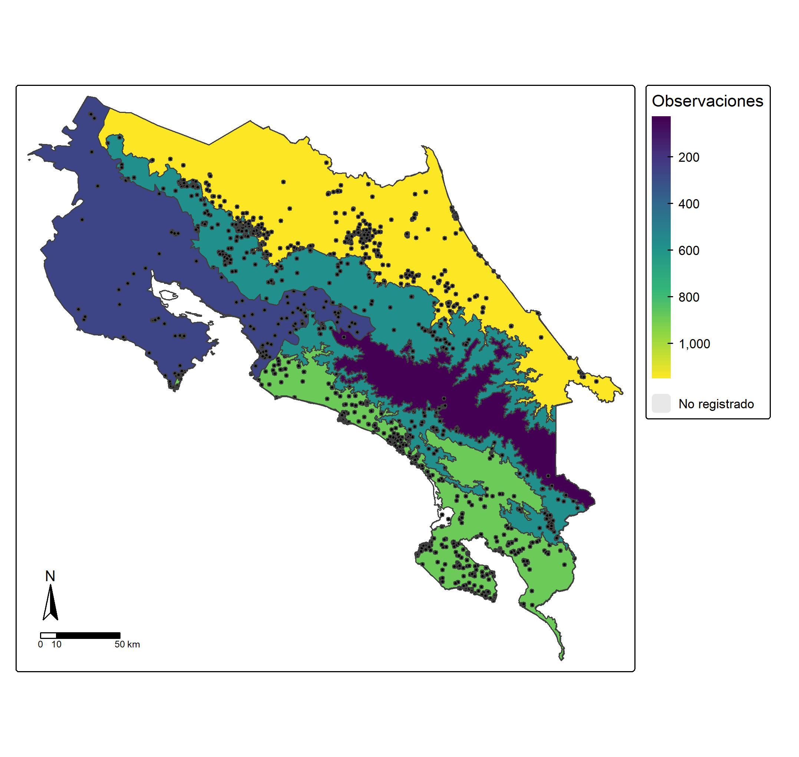

## Introducción

Los registros de ocurrencia adquieren mayor valor ecológico cuando se relacionan con unidades geográficas que permiten describir dónde se concentran las observaciones de una especie. Las divisiones administrativas (provincias y cantones) facilitan resumir y comunicar la distribución de los registros, mientras que las regiones biogeográficas de Savage permiten relacionarla con patrones ambientales y herpetofaunísticos del país. Esta práctica permitió integrar los registros depurados de Craugastor fitzingeri con capas espaciales de Costa Rica para cuantificar y visualizar su distribución geográfica, temporal y latitudinal.

## Objetivo

Asignar los registros de ocurrencia de *Craugastor fitzingeri* a provincias, cantones y regiones de Savage mediante análisis espacial en R, y elaborar mapas y gráficos que describan su distribución geográfica y temporal.

## Metodología

La práctica se realizó en RStudio con los paquetes sf, tmap, tidyverse y janitor. Se leyeron las capas de Costa Rica, cantones, provincias y regiones de Savage, se corrigieron sus geometrías, se transformaron a WGS84 (EPSG:4326) y se estandarizaron los nombres de sus columnas. Los registros depurados de la práctica anterior (occ_canton) se convirtieron en objeto espacial y, con st_join(), se asignó a cada uno su cantón, provincia y región de Savage. Los registros costeros que quedaron fuera de los polígonos de Savage se asignaron a la región más cercana con st_nearest_feature. Se contaron las observaciones por unidad y se elaboraron con tmap mapas coropléticos por provincia, cantón y región de Savage, con los registros superpuestos como puntos. Además, con ggplot2 se elaboraron gráficos de los cantones con más observaciones, la distribución temporal, la variación de los límites latitudinales y longitudinales por año, la densidad de observaciones por coordenadas y la primera observación por cantón. Todas las figuras se guardaron en JPG a 300 dpi.

## Resultados

Los registros de *Craugastor fitzingeri* se asignaron a las regiones de Savage de Costa Rica y se contó el número de observaciones en cada una. El mapa muestra en qué regiones se concentran las observaciones de la especie y en cuáles no hay registros, que se indican como «No registrado». Esta representación permite relacionar la ubicación de los registros con las regiones biogeográficas del país y explorar los patrones de distribución geográfica de la especie.

## Conclusiones

Aprendí a relacionar registros de ocurrencia con regiones biogeográficas mediante uniones espaciales (st_join()), a contar observaciones por región y a representarlas en un mapa coroplético con tmap.

Esto puede aplicarse a otras especies para identificar regiones con vacíos de información, priorizar sitios de muestreo y apoyar estudios de conservación y de manejo de áreas protegidas.
