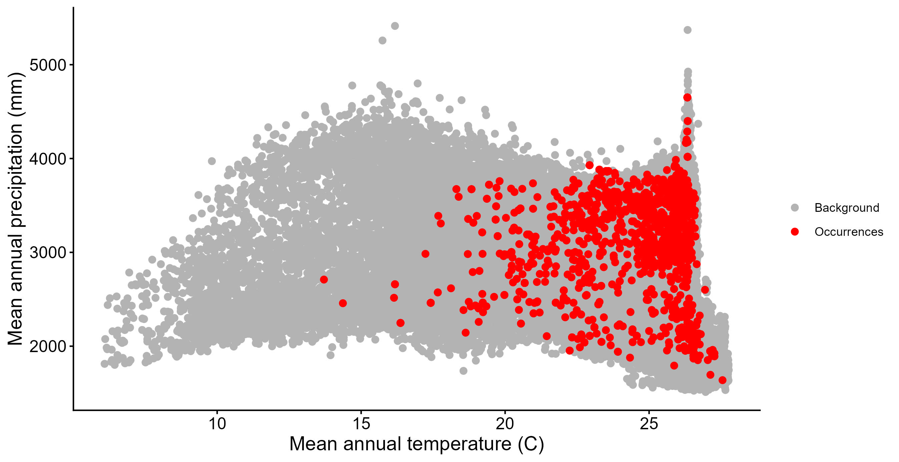

## Introducción

El nicho ambiental de una especie puede describirse comparando las condiciones donde se registró con las condiciones disponibles en el área de estudio. El nicho bidimensional hace esta comparación para pares de variables, como temperatura y precipitación, y permite ver qué parte del espacio ambiental ocupa la especie. Además, comparar los registros antiguos con los recientes permite explorar si la especie dejó de registrarse en ciertas condiciones, lo cual es útil para evaluar posibles declives. Esta práctica integró los registros de *Craugastor fitzingeri* con variables ambientales para caracterizar su nicho y comparar su ocupación a lo largo del tiempo.

## Objetivo

Extraer variables ambientales (temperatura, precipitación, elevación e índice de huella humana) en los sitios de registro de *Craugastor fitzingeri*, representar su nicho bidimensional frente al ambiente disponible en Costa Rica, y comparar los registros anteriores y posteriores al año 2000.

## Metodología

La práctica se realizó en RStudio con los paquetes terra, sf, tmap y tidyverse. Se leyeron las capas de Costa Rica y de Santa Elena y la base de registros depurados, que se convirtió en objeto espacial. Se cargaron los rásteres de elevación, índice de huella humana (HFI) y WorldClim, de los cuales se usaron la temperatura media anual (BIO_01) y la precipitación media anual (BIO_12). Se revisaron el sistema de coordenadas, la resolución y la extensión de los rásteres con compareGeom(). Como tenían la misma resolución y cuadrícula pero distinta extensión, la elevación se recortó con crop(). El HFI se remuestreó con resample() (método bilineal) para igualarlo a la cuadrícula de WorldClim. Los cuatro rásteres se combinaron en una sola pila. El ambiente disponible (background) se obtuvo convirtiendo todas las celdas de la pila en una tabla. Los valores ambientales de los registros se extrajeron con terra::extract() y se unieron a la tabla de ocurrencias, revisando los valores faltantes. Con ggplot2 se graficaron los registros contra el background para los pares temperatura–precipitación, elevación–HFI y temperatura–elevación. En la segunda parte, los registros se clasificaron según su fecha (antes y desde el año 2000) y se repitieron los gráficos diferenciando ambos grupos. También se elaboraron con tmap mapas de elevación y de HFI con los registros superpuestos y los límites de Costa Rica y de Santa Elena. Todas las figuras se guardaron en JPG a 300 dpi.

## Resultados

Los valores ambientales extraídos en los sitios de registro se compararon con el ambiente disponible en Costa Rica. El gráfico muestra qué rangos de temperatura media anual y precipitación media anual ocupa *Craugastor fitzingeri* dentro del espacio ambiental del país, representado por todas las celdas del área de estudio. Esta representación permite identificar qué parte de las condiciones climáticas disponibles en el país es ocupada por la especie y qué combinaciones de temperatura y precipitación no presentan registros.

## Conclusiones

Aprendí a combinar registros de ocurrencia con variables ambientales mediante rásteres, a extraer los valores ambientales en cada registro con terra::extract() y a representar el nicho bidimensional de una especie frente al ambiente disponible.
