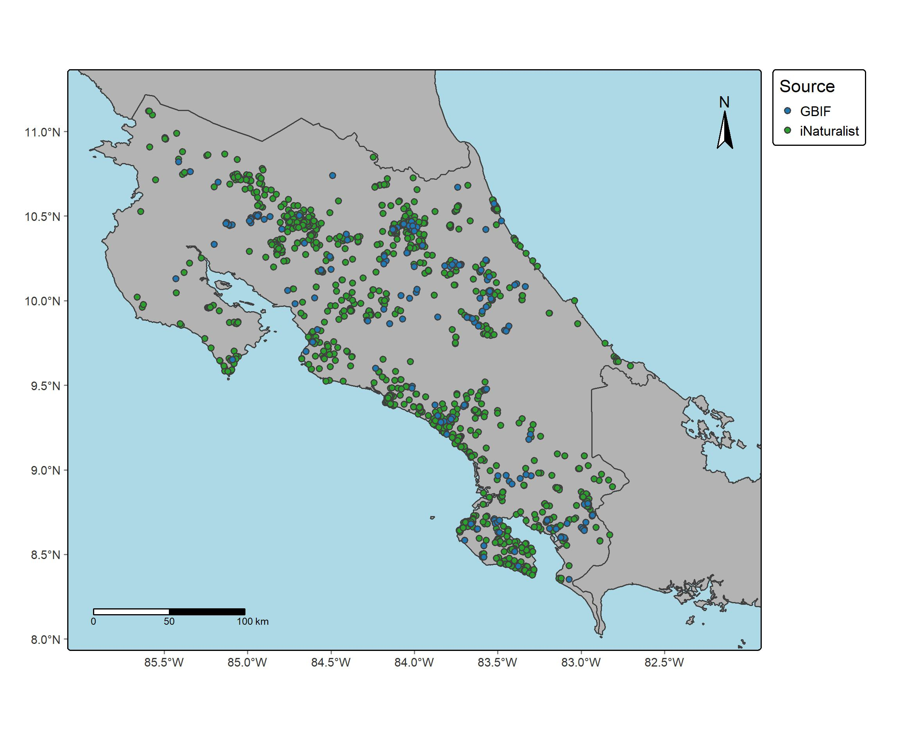

## Introducción

Los registros de ocurrencia permiten conocer la distribución geográfica de las especies a partir de observaciones realizadas en diferentes lugares y fechas. Las plataformas GBIF e iNaturalist ofrecen información que puede utilizarse en estudios ecológicos y de biodiversidad. Sin embargo, estos registros deben revisarse y depurarse para identificar datos incompletos, coordenadas incorrectas y observaciones duplicadas. Por ello, la práctica permitió conocer el proceso de descarga, organización y limpieza de registros de ocurrencia de *Craugastor fitzingeri* para su posterior utilización en análisis espaciales.

## Objetivo

Descargar y organizar registros de ocurrencia de *Craugastor fitzingeri* provenientes de GBIF e iNaturalist mediante R, y aplicar procedimientos básicos de revisión y limpieza de los datos geográficos para preparar bases de datos útiles para análisis posteriores.

## Metodología

La práctica se realizó en RStudio utilizando los scripts proporcionados en el curso. Primero, se configuraron las credenciales de GBIF mediante el archivo gbif_credentials.R. Después, se definió la especie de estudio, *Craugastor fitzingeri*, y se descargaron los registros de ocurrencia de GBIF mediante el paquete rgbif y de iNaturalist mediante rinat.

Posteriormente, se revisaron los registros obtenidos y se guardaron en formato RDS. Para integrar y depurar los datos se utilizaron los paquetes tidyverse, CoordinateCleaner y sf, con los que se estandarizaron las coordenadas y las fechas, se identificaron posibles errores geográficos y se seleccionaron los registros correspondientes a Costa Rica. Finalmente, se prepararon bases de datos para análisis espaciales y por cantón, y se generaron mapas mediante el paquete tmap.

## Resultados

La descarga inicial permitió obtener 5.608 registros de GBIF y 3.123 de iNaturalist. Después de integrar las fuentes y aplicar los filtros temporales y de calidad geográfica, se obtuvo una base de 4.591 registros. Mediante CoordinateCleaner se identificaron 23 registros con posibles problemas geográficos y 1.627 con coordenadas repetidas.

Posteriormente, se seleccionaron 3.099 ocurrencias correspondientes a Costa Rica: 487 de GBIF y 2.612 de iNaturalist. Esta base se utilizó para el análisis por cantón, mientras que para los análisis espaciales se conservaron 2.996 registros, al excluir las observaciones con coordenadas oscurecidas.

Finalmente, se generó un mapa de la distribución de las ocurrencias de *Craugastor fitzingeri* en Costa Rica según la fuente de información (Figura 1).

## Conclusiones

Aprendí a descargar registros de ocurrencia desde GBIF e iNaturalist utilizando R, integrar ambas fuentes y revisar la calidad de las coordenadas geográficas para preparar los datos para análisis espaciales.

Esta herramienta puede utilizarse para estudiar la distribución geográfica de otras especies, identificar áreas con registros de biodiversidad y generar información útil para investigaciones ecológicas y proyectos de conservación.
