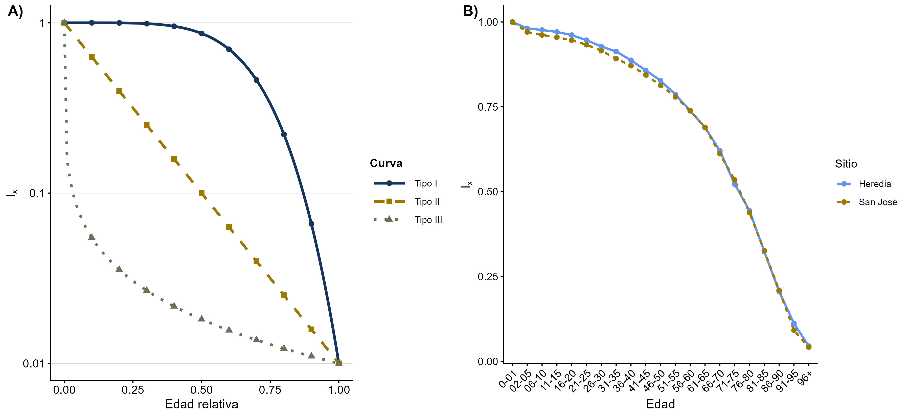

## Introducción

Las tablas de vida son herramientas utilizadas en la ecología de poblaciones para analizar la supervivencia y la mortalidad a diferentes edades. Permiten identificar patrones de supervivencia y compararlos con tres modelos teóricos: tipo I, caracterizado por una mortalidad elevada en edades avanzadas; tipo II, con una mortalidad relativamente constante durante la vida; y tipo III, con una mortalidad alta en las primeras etapas de vida. En esta práctica se utilizaron registros de mortalidad humana obtenidos de lápidas de los cementerios de Heredia y San José. Estos datos permitieron construir tablas de vida, analizar la distribución de las edades de muerte y comparar los patrones de supervivencia entre ambas localidades.

## Objetivo

Construir y analizar tablas de vida a partir de registros de mortalidad humana de los cementerios de Heredia y San José, con el propósito de caracterizar los patrones de supervivencia, compararlos con los modelos teóricos de curvas de supervivencia y evaluar las diferencias en las edades de muerte entre ambas localidades.

## Metodología

La práctica se desarrolló en RStudio mediante el lenguaje R y los paquetes tidyverse y gt. Se importaron y combinaron los registros de mortalidad de los cementerios de Heredia y San José, identificando su procedencia. Se calculó la edad de muerte, se revisaron y excluyeron temporalmente los valores inconsistentes y se agruparon las edades en 21 intervalos. Posteriormente, se calcularon las frecuencias de mortalidad por edad, localidad y sexo, y se elaboraron tablas de vida con indicadores de supervivencia y mortalidad. Finalmente, se exportaron los resultados a archivos CSV y DOCX, y se realizaron gráficos y pruebas estadísticas para comparar las curvas de supervivencia entre localidades y sexos.

## Resultados

Se analizaron inicialmente 1403 registros de mortalidad correspondientes al cementerio de Heredia y 1360 al Cementerio General de San José, para un total de 2763 registros antes de la revisión y exclusión de edades inválidas. En ambas localidades se registró una mayor cantidad de defunciones masculinas que femeninas. La tabla de vida permitió observar que la mortalidad específica por edad se mantuvo relativamente baja durante la niñez y la adultez temprana, mientras que aumentó a partir de los 46–50 años, con un incremento más marcado en las edades avanzadas. Por su parte, la proporción de sobrevivientes disminuyó progresivamente hasta la mediana edad y descendió con mayor rapidez durante la vejez. Los resultados fueron similares entre las dos localidades. En el intervalo de 96 años o más, la proporción de sobrevivientes fue de 0,045 en Heredia y 0,042 en San José. Este comportamiento se asemeja al patrón teórico de supervivencia tipo I, en el cual la mayoría de los individuos sobrevive hasta edades avanzadas y la mortalidad aumenta durante la vejez.

Las curvas de supervivencia (figura 1) de ambas localidades mostraron un patrón similar al tipo I, caracterizado por una supervivencia elevada durante gran parte de la vida y una disminución más pronunciada en edades avanzadas. En ambos cementerios, la proporción de sobrevivientes a los 61–65 años fue de aproximadamente 0,69, mientras que en el intervalo de 96 años o más disminuyó a 0,045 en Heredia y 0,042 en San José. Estos resultados indican que la supervivencia fue similar entre ambas localidades.

## Conclusiones

La práctica permitió aprender a construir tablas de vida a partir de registros de mortalidad y comprender cómo los indicadores de supervivencia y mortalidad cambian entre los intervalos de edad. También permitió reconocer la utilidad de estas herramientas para identificar patrones demográficos y compararlos entre localidades. Este conocimiento puede aplicarse en estudios de ecología de poblaciones para analizar la supervivencia de anfibios, reptiles y otros organismos, comparar la mortalidad entre poblaciones y comprender cómo varía la supervivencia a lo largo del ciclo de vida.
