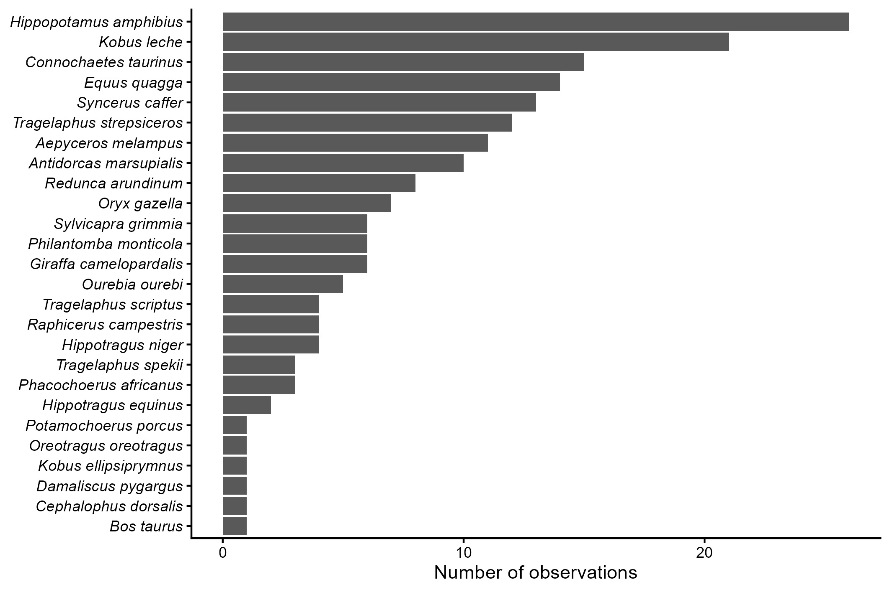

## Introducción

El ordenamiento de datos es un paso importante en el análisis de información biológica y ambiental, ya que permite organizar las observaciones y variables para facilitar su procesamiento e interpretación. El concepto de tidy data consiste en estructurar los datos de manera que cada variable corresponda a una columna, cada observación a una fila y cada tipo de unidad observacional a una tabla. En esta práctica se trabajó con bases de datos meteorológicos y registros de ungulados de Angola. Se utilizaron funciones de R para reorganizar columnas, separar y unir variables, modificar formatos de fecha, convertir datos a valores numéricos y separar la información taxonómica de las observaciones. Además, se generaron tablas resumen y gráficos para explorar los datos procesados.

## Objetivo

Aplicar herramientas del lenguaje R para organizar y transformar bases de datos en formato tidy data, facilitando su procesamiento, análisis y representación gráfica.

## Metodología

La práctica se desarrolló en el programa RStudio, utilizando el lenguaje R y paquetes como tidyverse, gt y funciones para la manipulación y visualización de datos. Primero, se trabajó con una base de datos meteorológicos que contenía información de cinco estaciones, incluyendo coordenadas, elevación, año, precipitación, nieve y temperaturas. Mediante funciones como pivot_longer() y pivot_wider(), se reorganizaron los datos para obtener una estructura en la que las observaciones y las variables estuvieran correctamente distribuidas. También se unieron las variables de año, mes y día para formar fechas, se separaron las temperaturas mínimas y máximas y se ajustaron los nombres y tipos de las columnas. Posteriormente, se calcularon valores promedio de variables climáticas por estación y se generó un gráfico para comparar las temperaturas mínimas y máximas. También se creó una tabla resumen con las condiciones climáticas medias registradas durante marzo entre 2010 y 2020. En el segundo ejercicio, se utilizó una base de datos de ungulados de Angola. Se combinaron las variables de año, mes y día para crear fechas, se unieron los nombres de género y especie y se separó la información taxonómica en categorías como clase, orden y familia. Finalmente, se organizaron las observaciones y la taxonomía en tablas independientes, se guardaron los datos procesados y se elaboró un gráfico del número de observaciones por especie.

## Resultados

En el ejercicio de datos meteorológicos, la base de datos original contenía 165 filas y 41 columnas. Mediante la transformación de los datos, la información se organizó por fecha, estación meteorológica y variable climática. Además, se separaron las temperaturas mínimas y máximas y se convirtieron las variables correspondientes a valores numéricos. Con estos datos, se elaboró un gráfico para comparar las temperaturas medias mínimas y máximas de cinco estaciones meteorológicas durante el mes de marzo del periodo 2010–2020. También se generó una tabla con los promedios de precipitación, nieve y temperatura para cada estación.

En el ejercicio de ungulados de Angola, se analizaron 186 observaciones correspondientes a 26 especies. Los datos se organizaron para facilitar la identificación de las especies y la contabilización de sus registros. La especie con mayor número de observaciones fue *Hippopotamus amphibius*, con 26 registros, seguida de *Kobus leche*, con 21, y *Connochaetes taurinus*, con 15. En cuarto lugar se encontró *Equus quagga*, con 14 observaciones, mientras que *Syncerus caffer* presentó 13 registros.

## Conclusiones

La práctica permitió comprender la importancia de organizar adecuadamente las bases de datos antes de realizar análisis estadísticos o generar gráficos. Estas herramientas pueden aplicarse en investigaciones biológicas, por ejemplo, al organizar registros de especies, observaciones de campo, variables ambientales o datos de monitoreo de anfibios y reptiles. Una de las principales dificultades puede ser comprender cómo reorganizar los datos sin perder la relación entre las variables.
