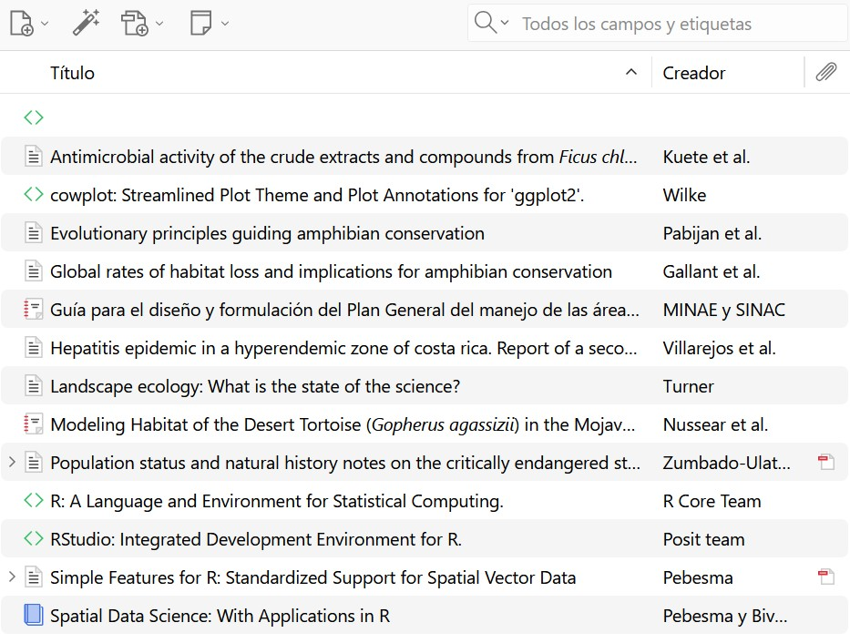

## Introducción

La practica de gestion de refrencias bibliograficas con zotero corresponde a realizar citas y referencias de forma mas sencilla, en donde se pueden crear de distintas formas y por diferentes rutas.

## Objetivo

-   Al finalizar este tutorial, el estudiante será capaz de:

<!-- -->

-   Crear y organizar una biblioteca bibliográfica en Zotero.

<!-- -->

-   Incorporar referencias mediante DOI, archivos RIS y Zotero Connector.

<!-- -->

-   Revisar y corregir los metadatos de una referencia.

<!-- -->

-   Instalar y utilizar un estilo bibliográfico.

<!-- -->

-   Insertar citas y bibliografías automáticamente en Microsoft Word.

<!-- -->

-   Incorporar referencias que no corresponden a artículos científicos, como reportes, páginas web y software.

<!-- -->

-   Citar R, RStudio y paquetes de R.

## Metodología

Primero, se hace la prepsracion de zotero, en donde se crea una colección, seguidamente se comprueba la integración con Microsoft Word. Para la siguente parte, se incorporan las referencias a Zotero, mediante diferentes formas;

1- Agregar una referencia mediante DOI

2- Importar un archivo RIS

3- Zotero Connector

Como otra parte, se debe revisar y corregir las referencias, este es un paso muy importante. Se debe revisar, titulo, nombre cinetifico, autores, tipo de documento. Posteriormente se elige un estilo bibliografico.

Para posteriormente inscertar citas en word, las cuales son citas parenteticas y narrativas. Y poder crear automáticamente la bibliografía.

Tambien se aprendera a referencias lo que no son artículos científicos, por ejemplo, reportes y documentos institucionales.

Tambien citar R y los paquetes utilizados, citar RStudio

## Resultados

Amphibian conservation [@pabijan_evolutionary_2020]

Actividad antimicrobiana [@kuete_antimicrobial_2008]

Cuadro 1. Métodos utilizados para incorporar referencias bibliográficas a Zotero.

| Método | Cuándo utilizarlo? |
|------------------------------------|------------------------------------|
| DOI | Clizarlo?uando la publicación tiene un DOI |
| Archivo RIS | Cuando la revista o base de datos permite exportar la referencia |
| Zotero Connector | Para capturar referencias directamente desde el navegador |
| Entrada manual | Cuando la información no puede importarse automáticamente |

## Conclusiones

Aprendimos a realizar referencias y citas de forma mas rapida y automatizada

## Referencias
